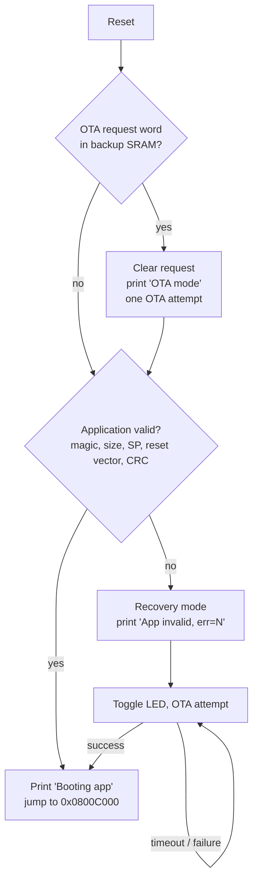
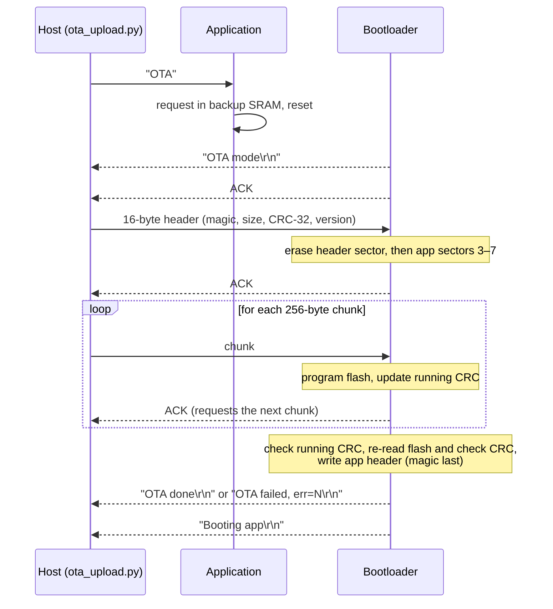

# STM32F4 OTA Bootloader

A bootloader for the **STM32F446RE** that updates the application firmware over **Bluetooth** (HC-05 module on USART1). It comes with a demo application and a Python upload script.

- The running application reboots into the bootloader when it receives `OTA` over Bluetooth.
- Images are checked with CRC-32 twice: once over the received bytes and again over what was written to flash.
- An image is marked valid only after it verifies. If an update is interrupted, the bootloader stays in **recovery mode** and accepts a new upload. The board never jumps into a half-written image.

## Contents

- [Repository layout](#repository-layout)
- [Hardware](#hardware)
- [Flash memory map](#flash-memory-map)
- [How it works](#how-it-works)
- [Building](#building)
- [First-time flashing](#first-time-flashing)
- [Updating over Bluetooth](#updating-over-bluetooth)
- [Status messages and error codes](#status-messages-and-error-codes)
- [Writing your own application](#writing-your-own-application)
- [Limitations](#limitations)

## Repository layout

```
STM32F446_Bootloader/      Bootloader (STM32CubeMX + CMake project), 32 KB at 0x08000000
  Core/Inc/flash_layout.h    Flash map: the single source of truth for addresses
  Core/Inc/app_header.h      Application header stored in sector 2
  Core/Src/main.c            Boot decision, UART transport, recovery loop
  Core/Src/bl_ota.c          OTA receive / erase / program / verify
  Core/Src/bl_jump.c         Image validation and jump to the application
  Core/Src/flash_operations.c  Sector erase and word programming
  Core/Src/crc32.c           CRC-32 (IEEE 802.3, same as Python's zlib.crc32)
STM32F446_Application/     Demo application linked for 0x0800C000
Shared/boot_shared.h       OTA request handshake used by both projects
tools/ota_upload.py        Host-side upload tool
```

## Hardware

| Item | Details |
|---|---|
| MCU | STM32F446RE (LQFP64), for example a NUCLEO-F446RE |
| Clock | HSI 16 MHz, no PLL (both projects) |
| Bluetooth | HC-05 in data mode on **USART1**, 9600 baud, 8N1 (the HC-05 default) |
| UART pins | **PA9** = USART1_TX → HC-05 RXD, **PA10** = USART1_RX ← HC-05 TXD, plus a common GND |
| LED | **PA0**: blinks every 500 ms while the demo app runs; toggles about every 10 s in recovery mode |
| Programmer | SWD (PA13/PA14), needed once to flash the bootloader |

Power the HC-05 according to its module's specification. Its UART logic level is 3.3 V, which matches the STM32.

## Flash memory map

| Sectors | Address | Size | Contents |
|---|---|---|---|
| 0–1 | `0x08000000` | 32 KB | Bootloader |
| 2 | `0x08008000` | 16 KB | Application header (`app_header_t`) |
| 3–7 | `0x0800C000` | 464 KB | Application image |

The application header is five little-endian `uint32` words:

| Offset | Field | Notes |
|---|---|---|
| 0x00 | `reserved` | Always `0xFFFFFFFF` |
| 0x04 | `magic` | `0xDEADBEEF`, written **last** so a header cut short by power loss is never valid |
| 0x08 | `size` | Image size in bytes |
| 0x0C | `crc` | CRC-32 of the image |
| 0x10 | `version` | Firmware version; stored, not checked |

These addresses are defined in [flash_layout.h](STM32F446_Bootloader/Core/Inc/flash_layout.h). The application's linker script, its `VECT_TAB_OFFSET`, and the constants at the top of [ota_upload.py](tools/ota_upload.py) all have to match them.

## How it works

### Boot flow



1. **Requesting an update.** When the application receives the text `OTA` on USART1, it calls `boot_request_ota_and_reset()` from [boot_shared.h](Shared/boot_shared.h). That writes `0x4F544121` ("OTA!") to the first word of backup SRAM (`BKPSRAM_BASE`) and does a software reset. Backup SRAM survives the reset, and neither project's startup code touches it.
2. **The bootloader reads and clears the request** at every boot. Because the request is consumed, a timed-out update does not cause a reboot loop. If no host shows up within 10 s, nothing has been erased yet, so the existing application boots normally.
3. **Validation** (`bootloader_is_app_valid()` in [bl_jump.c](STM32F446_Bootloader/Core/Src/bl_jump.c)) checks the header magic and size, checks that the initial stack pointer is in RAM, checks that the reset vector is a Thumb address inside the image, and compares the CRC-32 of the image with the header.
4. **The jump** de-initializes the HAL, stops SysTick, disables and clears every NVIC interrupt, sets `VTOR` to `0x0800C000`, loads the application's stack pointer, and calls its reset handler.

### OTA protocol

All traffic runs over USART1 / HC-05. The bootloader drives the flow control: it sends one ACK byte (`0x06`) each time it is ready for the next block, then waits up to **10 s** for that block.



The host header is four little-endian `uint32` values: `magic` (`0xDEADBEEF`), `image_size`, `crc` (CRC-32 of the image only), and `version`. The last chunk may be shorter than 256 bytes; the bootloader pads its final flash word with `0xFF`.

The old application is erased **only after** the header has been accepted. If the header is rejected (errors −1 to −3), nothing has been erased and it is safe to retry. If anything fails after the erase, there is no valid application, so the bootloader stays in recovery mode until an upload succeeds.

## Building

Both firmware projects are STM32CubeMX-generated CMake projects targeting `arm-none-eabi-gcc` (Cortex-M4, hard-float FPU, newlib-nano). They were set up with the **STM32Cube for VS Code** extension. Open either project folder in VS Code, select the `Debug` or `Release` preset, and build.

From the command line, with `cmake` ≥ 3.22, `ninja` and `arm-none-eabi-gcc` on `PATH`:

```sh
cd STM32F446_Bootloader
cmake --preset Debug
cmake --build --preset Debug
# -> build/Debug/STM32F446_Bootloader.elf

cd ../STM32F446_Application
cmake --preset Debug
cmake --build --preset Debug
# -> build/Debug/STM32F446_Application.elf
#    build/Debug/STM32F446_Application.bin   (post-build objcopy, used for OTA)
```

The upload tool needs Python 3 and `pyserial`:

```sh
pip install pyserial
```

## First-time flashing

**1. Flash the bootloader over SWD**, for example with STM32CubeProgrammer:

```sh
STM32_Programmer_CLI -c port=SWD -w STM32F446_Bootloader/build/Debug/STM32F446_Bootloader.elf -v -rst
```

With no valid application on the chip yet, the bootloader prints `App invalid, err=1, waiting for OTA` and enters recovery mode.

**2. Load the first application**, using one of these two methods:

- **Option A: over Bluetooth.** Since the board is already in recovery mode, skip the trigger:

  ```sh
  python tools/ota_upload.py STM32F446_Application/build/Debug/STM32F446_Application.bin -p COM5 --no-trigger
  ```

- **Option B: over SWD.** Generate the matching header and program both files:

  ```sh
  python tools/ota_upload.py STM32F446_Application/build/Debug/STM32F446_Application.bin --header-out header.bin
  STM32_Programmer_CLI -c port=SWD -w STM32F446_Application/build/Debug/STM32F446_Application.bin 0x0800C000 -v
  STM32_Programmer_CLI -c port=SWD -w header.bin 0x08008000 -v -rst
  ```

> **Debugging the application with a debugger:** the bootloader only jumps to an image whose header matches it. If you flash a rebuilt application over SWD without regenerating and flashing its header, the bootloader reports `App invalid, err=1` (no header) or `err=5` (CRC mismatch) and stays in recovery mode.

## Updating over Bluetooth

1. Pair the HC-05 with your computer (the PIN is usually `1234` or `0000`) and find its serial port (`COMx` on Windows, `/dev/rfcomm0` or similar on Linux).
2. Close any serial monitor that has the port open.
3. Run the following from the repository root:

```sh
python tools/ota_upload.py STM32F446_Application/build/Debug/STM32F446_Application.bin -p COM5
```

The tool sends `OTA` to the running application, waits for the bootloader, sends the header and image with a progress bar, and confirms that the new application booted. It checks the `.bin` before anything is erased: it refuses ELF/HEX files, images that are too large, and images whose stack pointer or reset vector shows they were not linked for `0x0800C000`.

| Option | Default | Description |
|---|---|---|
| `bin` | (required) | Application `.bin` linked for `0x0800C000` |
| `-p`, `--port` | | Serial port of the HC-05 (any pyserial URL works) |
| `-b`, `--baud` | `9600` | Baud rate |
| `--fw-version N` | `1` | Version number stored in the application header |
| `--no-trigger` | off | Don't send `OTA` first; use when the board is already in recovery mode |
| `--connect-timeout S` | `25` | Seconds to wait for the bootloader's first ACK |
| `--retries N` | `2` | Retries when the bootloader rejects the header |
| `--header-out FILE` | | Also write the 20-byte application header for flashing by hand |

At 9600 baud, transfer speed is under 1 KB/s, because each 256-byte chunk waits for an ACK round trip over Bluetooth. Erasing sectors 2–7 takes several seconds before the first chunk is sent.

If an upload fails after the erase, the tool says so. Run it again with `--no-trigger`; the bootloader is waiting in recovery mode.

## Status messages and error codes

The bootloader prints these lines on USART1, so they also show up in the upload tool and in any Bluetooth serial terminal:

| Message | Meaning |
|---|---|
| `OTA mode` | The application requested an update; one attempt follows |
| `OTA done` | Image received, verified in flash, header written |
| `OTA failed, err=N` | See the OTA errors below |
| `Booting app` | Jumping to the application |
| `App invalid, err=N, waiting for OTA` | See the validation errors below; entering recovery mode |

**OTA errors** (`bl_ota_run()`, [bl_ota.h](STM32F446_Bootloader/Core/Inc/bl_ota.h)):

| err | Meaning | Old app erased? |
|---|---|---|
| −1 | No header arrived within 10 s | No |
| −2 | Header magic is not `0xDEADBEEF` | No |
| −3 | Image size is 0 or larger than 464 KB | No |
| −4 | Erasing the header or application sectors failed | Yes |
| −5 | A data chunk did not arrive within 10 s | Yes |
| −6 | Programming flash failed | Yes |
| −7 | CRC of the received data does not match the header | Yes |
| −8 | CRC read back from flash does not match the header | Yes |
| −9 | Writing the application header failed | Yes |

**Application validation errors** (`bootloader_is_app_valid()`, [bl_jump.h](STM32F446_Bootloader/Core/Inc/bl_jump.h)):

| err | Meaning |
|---|---|
| 1 | No header, or the header magic is wrong |
| 2 | Header size is under 8 bytes or larger than the application area |
| 3 | Initial stack pointer is not in RAM |
| 4 | Reset vector is not a Thumb address inside the image |
| 5 | Image CRC does not match the header |

## Writing your own application

To run under this bootloader, an application must:

1. **Link for `0x0800C000`.** In its linker script, set:
   ```
   FLASH (rx) : ORIGIN = 0x800C000, LENGTH = 464K
   ```
2. **Relocate its vector table.** Define `USER_VECT_TAB_ADDRESS` and `VECT_TAB_OFFSET=0x0000C000U` for `system_stm32f4xx.c`. The demo does this in [its CMakeLists.txt](STM32F446_Application/CMakeLists.txt) on the `stm32cubemx` interface target, so the definitions reach the CubeMX driver library. (The bootloader also sets `VTOR` before jumping, but `SystemInit()` should not undo it.)
3. **Produce a raw `.bin`** for the upload tool. The demo adds an `objcopy -O binary` post-build step.
4. **Provide a way to enter OTA.** Add `../Shared` to the include path, `#include "boot_shared.h"`, and call `boot_request_ota_and_reset()` when an update is requested. The demo watches USART1 for the string `OTA` (`ota_command_poll()` in [main.c](STM32F446_Application/Core/Src/main.c)), which is what `ota_upload.py` sends. Any other trigger works too, such as a button or a different command, as long as the host is ready to answer the bootloader's ACK.

The application must not use the first word of backup SRAM for anything else.


